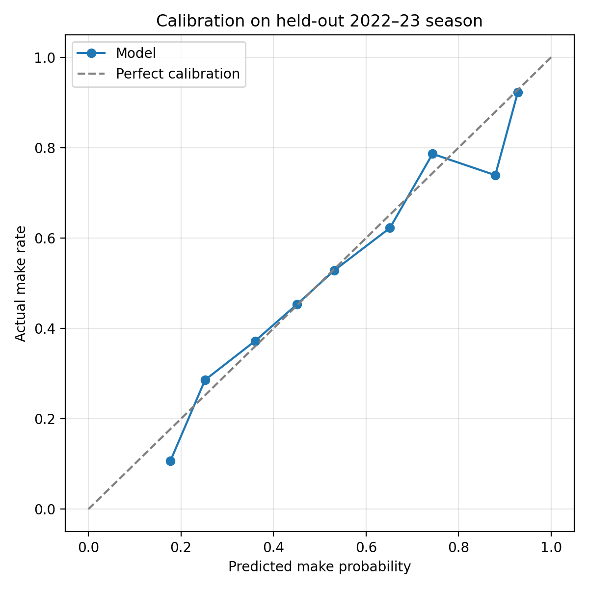
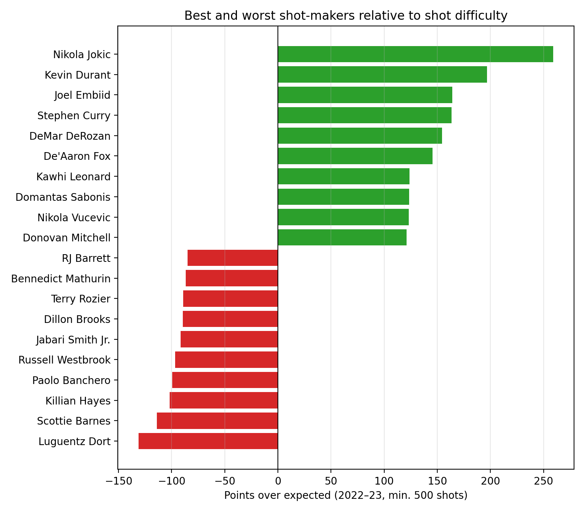

# NBA-Shot-Quality
Which players and teams take the best shots, and who makes more than expected. Grouping and sorting shot data to train a logistic regression that predicts whether a shot goes in from its distance, angle, and type. Then, comparing each player's percentage to the model's expected percentage. The difference shows who makes more than expected.

A 24-ft three is worth about **1.10 points** per attempt versus about **0.78** for a 20-ft two.
Shots at the rim are the most valuable (about 1.49), and long twos are the least (about 0.73).

I trained a logistic regression on 2018–19 to 2021–22 and tested it on the held-out 2022–23 season.
Inputs: shot distance (and distance squared), 2 vs. 3, shot type, period, and an end-of-period flag for heaves.

| Metric | Model | Baseline (league average) |
|---|---|---|
| Log loss | 0.6485 | 0.6922 |
| AUC | 0.649 | 0.500 |

The model is well calibrated between about 25% and 75%, where nearly all shots fall:
a shot it rates at 45% goes in about 45% of the time. The extremes are noisier
because they contain few shots (end-of-quarter heaves at the low end, dunks and tip-ins at the high end).

## Who makes more shots than expected?

For every 2022–23 shot, I compared the points actually scored with the points an average
player would be expected to score on that same shot. Summing the difference gives
**points over expected**, a measure of shot-making that accounts for shot difficulty.

- **The top of the list passes the eye test:** Jokić, Durant, Embiid (2022–23 MVP) and Curry lead the league.
- **DeRozan ranks 5th**, even though the model rates midrange shots as low-value. He is an elite
  midrange shooter, which shows the model separates shot *difficulty* from shot *making*.
- **The bottom of the list** is mostly rookies (Banchero, Mathurin, Jabari Smith Jr.) and players
  known for inefficient shooting.

## Limitations

- The play-by-play data has shot distance but no exact court location, so the model can't
  tell a corner three from a top-of-the-key three.
- It doesn't know about defenders, so players who create tough, contested shots for themselves
  are probably underrated.
- About 9% of shots had no recorded distance; I filled these with the median distance for that
  shot type. Filled-in threes shot slightly better (38.8% vs. 35.3%), suggesting made threes are
  somewhat more likely to lack a distance.
- During data checks, the three-point rate came out at half the league average, which revealed
  that blocked shots were pulling the wrong description. I fixed it by always using the
  shooter's description.

## How to run

1. Download the [NBA Database](https://www.kaggle.com/datasets/wyattowalsh/basketball) from Kaggle
   and put `NBA.sqlite` in `data/`.
2. Install packages: `pip install duckdb pandas scikit-learn matplotlib jupyter`
3. Run `notebooks/01_explore.ipynb` from top to bottom. The SQL is also in `sql/`.