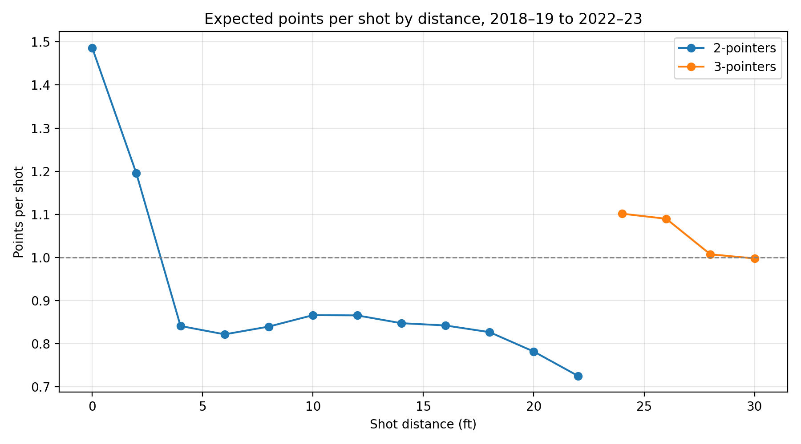
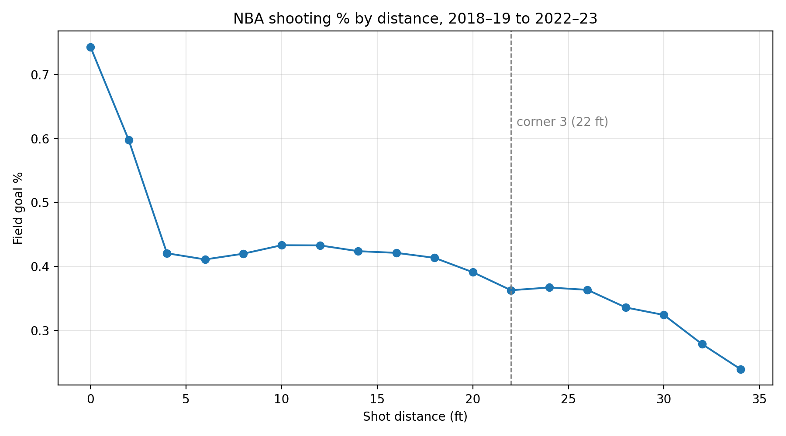

# NBA-Shot-Quality
Which players and teams take the best shots, and who makes more than expected. Grouping and sorting shot data to train a logistic regression that predicts whether a shot goes in from its distance, angle, and type. Then, comparing each player's percentage to the model's expected percentage. The difference shows who makes more than expected.

About 9% of shots had no recorded distance; I filled these with the median distance for that shot type. Filled-in threes shot slightly better (38.8% vs. 35.3%), suggesting made threes are somewhat more likely to lack a distance in the play-by-play data.

A 24-ft three is worth about **1.10 points** per attempt versus about **0.78** for a 20-ft two.
Shots at the rim are the most valuable (about 1.49), and long twos are the least (about 0.73).

